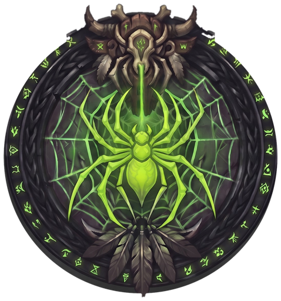
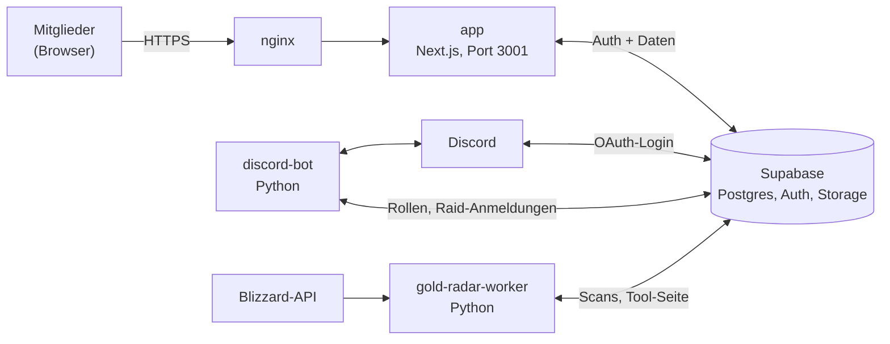

<p align="center">
  
</p>

<h1 align="center">Black Cocoon · Gilden-Website für WoW Forever</h1>

<p align="center">
  Website, Discord-Bot und Auktionshaus-Tool der Gilde <b>Black Cocoon</b> (Horde, PvP, EU).<br>
  Mitglieder melden sich mit Discord an und finden alles an einem Ort: Umfragen, Raid-Planung,
  Guides und mit <b>Blackwater Terminal</b> ein eigenes Gold-Tool.
</p>

<p align="center">
  
  
  
  
  
  
</p>

---

## Inhalt

- [Funktionen](#funktionen)
- [Aufbau](#aufbau)
- [Schnellstart](#schnellstart)
- [Deployment](#deployment)
- [Umgebungsvariablen](#umgebungsvariablen)
- [Rechte und Rollen](#rechte-und-rollen)
- [Datenschutz](#datenschutz)
- [Projektstruktur](#projektstruktur)
- [Weitere Dokumentation](#weitere-dokumentation)

## Funktionen

Alle Seiten außer der Startseite brauchen einen Discord-Login. Die Oberfläche gibt es auf Deutsch
und Englisch.

### Gilde

| Seite | Was sie macht |
|---|---|
| `/umfrage` | Fragebogen pro Person: Klassen nach Priorität, zwei Berufe, Kommentar. Jede Antwort lässt sich jederzeit ändern oder löschen. |
| `/uebersicht` | Übersicht aller Teilnehmer für eingeloggte Mitglieder, ohne sensible Detailfelder |
| `/verfuegbarkeit` | Wochentage und Tageszeiten, an denen jemand meistens spielen kann |
| `/charaktere` | Eigene Charaktere (Klasse, Rolle, Level, Main/Twink) und das Gilden-Roster nach Rollen |
| `/termine` | Raids und Termine mit Anmeldung (*Dabei*, *Vorläufig*, *Abgemeldet*). Auf Wunsch wöchentlich wiederkehrend. Dieselben Anmeldungen gibt es auch im Discord. |
| `/fraktionen` | Gildenabstimmung über die Gildenkonzepte |
| `/gildenname` | Namensvorschläge und Abstimmung über den Gildennamen |
| Startseite | Countdown zum Launch und kurze Abstimmungen |
| `/guides` | Faktengeprüfte Guides zu WoW Forever mit Item-Tooltips |
| `/downloads` | Dateien und Tools für die Gilde |

### Blackwater Terminal

Das Auktionshaus-Tool der Gilde unter `/gold-radar`, nur für Mitglieder mit der passenden
Discord-Rolle. Es zeigt in einer Ansicht:

- welche Mats wann gefragt sind,
- welche Mobs sich zum Kürschnern oder Angeln lohnen,
- was im AH gerade zu billig ist,
- welche Rezepte Gewinn bringen.

Die Preise kommen aus Scans, die Mitglieder hochladen, und aus der Blizzard-API. Ein eigener Worker
misst daraus echte Verkäufe. Details: [docs/BLACKWATER-TERMINAL.md](docs/BLACKWATER-TERMINAL.md).

### Admin-Bereich

- **`/admin`:** Auswertung der Umfrage mit Diagrammen, Tabelle, CSV-Export und Notizen.
  Außerdem lassen sich hier kurze Abstimmungen, Downloads und das Logo verwalten.
- **`/admin/texte`:** Texte der Website direkt im Browser bearbeiten.
- **`/admin/fraktionen`:** Gildenkonzepte für die Abstimmung anlegen.
- **`/admin/gold-radar`:** Nutzung, Uploads, Feedback und Tool-Daten des Blackwater Terminals.

### Discord-Bot

Ein Bot in [`discord-setup/`](discord-setup/README.md) verbindet den Discord-Server mit der Website:

- Raid-Anmeldung im Discord, synchron mit `/termine`.
- Rollen-Sync: Ränge und Zugangsrollen landen alle 2 Minuten in der Datenbank.
- Bewerbungs-Tickets, Mod-Log und Willkommens-Nachricht.
- Blizzard-Blueposts zu WoW Forever.

## Aufbau



Drei Docker-Container laufen nebeneinander (`docker-compose.yml`):

| Dienst | Aufgabe |
|---|---|
| `app` | Die Next.js-Website. Sie ist nur intern auf `127.0.0.1:3001` erreichbar, das vorhandene nginx leitet von außen weiter. |
| `discord-bot` | Gilden-Bot (`discord-setup/`), eigene `.env` |
| `gold-radar-worker` | Liest Scan-Uploads, die Blizzard-API und TSM ein und baut die Seite des Blackwater Terminals neu. Er nutzt dieselbe `.env` wie die App. |

**Technik:**

- Next.js 15 (App Router, Server Actions) mit TypeScript.
- Tailwind CSS, Recharts für Diagramme, Tiptap als Texteditor.
- Supabase für Discord-OAuth, Postgres mit Row Level Security und Storage.
- Bot und Worker in Python 3.12. Der Worker nutzt nur die Standardbibliothek.

## Schnellstart

Voraussetzungen: Node.js 20, ein Supabase-Projekt und eine Discord-App. Wie man beides einrichtet,
steht Schritt für Schritt in [docs/SETUP.md](docs/SETUP.md).

1. Repository klonen:
   ```bash
   git clone https://github.com/kuestersrene-beep/Wowforever.git
   ```
2. In den Ordner wechseln:
   ```bash
   cd Wowforever
   ```
3. Die Vorlage für die Umgebungsvariablen kopieren:
   ```bash
   cp .env.local.example .env.local
   ```
4. Supabase-URL, Keys und die eigene Discord-ID in `.env.local` eintragen.
5. `supabase/schema.sql` im Supabase SQL Editor ausführen. Das Skript ist wiederholbar.
6. Abhängigkeiten installieren:
   ```bash
   npm install
   ```
7. Den Entwicklungsserver starten:
   ```bash
   npm run dev
   ```

Danach läuft die Seite unter <http://localhost:3000>.

## Deployment

Die Website läuft per Docker Compose auf einem eigenen Server hinter nginx mit HTTPS über certbot.
Die vollständige Anleitung steht in [docs/SETUP.md](docs/SETUP.md#6-deployment-auf-deinem-eigenen-server-hetzner-neben-einem-bestehenden-nginx).
Ein Beispiel für die nginx-Seite liegt in [`deploy/nginx-wowforever.conf.example`](deploy/nginx-wowforever.conf.example).

Ein Update auf dem Server holt den neuen Stand und baut alle Container neu:

```bash
git pull && docker compose up -d --build
```

Logs eines Dienstes:

```bash
docker compose logs -f app
```

> [!NOTE]
> `NEXT_PUBLIC_*`-Werte baut Next.js beim Build fest ein. Wer sie ändert, muss die App neu bauen.

## Umgebungsvariablen

Die Vorlage mit Erklärungen ist [`.env.local.example`](.env.local.example).

| Variable | Pflicht | Wofür |
|---|---|---|
| `NEXT_PUBLIC_SUPABASE_URL` | ja | Adresse des Supabase-Projekts |
| `NEXT_PUBLIC_SUPABASE_ANON_KEY` | ja | Öffentlicher Supabase-Key, durch Row Level Security abgesichert |
| `SUPABASE_SERVICE_ROLE_KEY` | ja | Voller Datenbankzugriff, **nur serverseitig**, niemals mit `NEXT_PUBLIC_` |
| `ADMIN_DISCORD_IDS` | ja | Feste Admins als Notfall-Zugang, kommagetrennt |
| `DISCORD_WEBHOOK_URL` | nein | Benachrichtigungen zu Umfrage, Terminen und Aufstellungen |
| `NEXT_PUBLIC_LAUNCH_DATE` | nein | Countdown auf der Startseite (`JJJJ-MM-TT`) |
| `NEXT_PUBLIC_SURVEY_DEADLINE` | nein | Hinweis „Bitte antworte bis …“ |
| `NEXT_PUBLIC_DISCORD_INVITE_URL`, `NEXT_PUBLIC_DISCORD_APPLY_URL` | nein | Links zum Discord und zur Bewerbung |
| `NEXT_PUBLIC_TIME_ZONE` | nein | Zeitzone der Termine, Standard `Europe/Berlin` |
| `GOLD_RADAR_ROLES` | nein | Discord-Rollen mit Zugang zum Blackwater Terminal, Standard `Gold-Radar,Beta-Tester` |
| `GOLD_RADAR_ADMIN_IDS` | nein | Wer Nutzung und Uploads des Tools sieht und Daten hochladen darf |
| `GOLD_RADAR_RULESET`, `GOLD_RADAR_RULESETS` | nein | Auktionshaus bzw. Auktionshäuser, z. B. `pvp-eu-horde` |
| `GOLD_RADAR_FEEDBACK_WEBHOOK` | nein | Tool-Feedback zusätzlich in einen Discord-Kanal |
| `BLIZZARD_CLIENT_ID`, `BLIZZARD_CLIENT_SECRET` | nein | Blizzard-API für das ganze Auktionshaus, stündlich |
| `GOLD_RADAR_TSM`, `GOLD_RADAR_BLIZZARD` | nein | Datenquellen des Workers fest einstellen |

Der Bot hat eine eigene `.env` in `discord-setup/`, siehe [discord-setup/README.md](discord-setup/README.md).

## Rechte und Rollen

| Wer | Darf |
|---|---|
| Alle Eingeloggten | Eigene Umfrage, Verfügbarkeit, Charaktere und Anmeldungen bearbeiten. Roster, Termine und Übersicht sehen. |
| **Offizier**, **Gildenmeister** (Discord-Rang) und `ADMIN_DISCORD_IDS` | Admin-Bereich, Termine anlegen, Aufstellungen setzen und posten |
| Discord-Rolle aus `GOLD_RADAR_ROLES` | Blackwater Terminal nutzen und Scans hochladen |
| `GOLD_RADAR_ADMIN_IDS` | Nutzung, Uploads und Feedback des Tools sehen, Tool-Daten hochladen |

Die Discord-Ränge meldet der Bot (`discord-setup/rollensync.py`) alle 2 Minuten in die Tabelle
`discord_members`. Row Level Security sorgt dafür, dass jede Person nur ihre eigenen Daten ändert.
Alles, was Admins schreiben, läuft serverseitig über den `service_role`-Key.

## Datenschutz

- Gespeichert werden nur Discord-ID, Anzeigename, Avatar und die Angaben, die jemand selbst einträgt.
  E-Mail-Adressen und andere Discord-Daten werden nicht gespeichert.
- Jede Person kann ihre Umfrageantwort jederzeit vollständig löschen.
- Es gibt kein Tracking, keine Analytics und nur die technisch nötigen Login-Cookies von Supabase.
- Das Blackwater Terminal protokolliert nur Discord-ID, Anzeigename, Zeitpunkt und Ruleset eines Aufrufs.
- Hochgeladene Scans und die Tool-Seite liegen in einem privaten Storage-Bucket ohne öffentliche
  Policies.

## Projektstruktur

```
app/                        Seiten (Next.js App Router) und Server Actions
  page.tsx                  Startseite mit Login, Countdown und kurzen Abstimmungen
  umfrage/ uebersicht/      Fragebogen und Teilnehmer-Übersicht
  verfuegbarkeit/           Verfügbarkeit
  charaktere/ termine/      Charaktere, Roster, Raid-Termine und Anmeldung
  fraktionen/ gildenname/   Gildenabstimmung und Namensumfrage
  kurzabstimmung/           Server Actions der kurzen Abstimmungen
  guides/ downloads/        Guides und Dateien
  gold-radar/               Blackwater Terminal: Auslieferung, Scan-Upload, Feedback
  admin/                    Auswertung, Texte, Gildenkonzepte, Tool-Verwaltung
  auth/callback/            OAuth-Callback von Discord über Supabase
components/                 UI-Komponenten (admin/, events/, factions/, guildname/, …)
lib/                        Supabase-Clients, Rechte, Discord, Inhalte, i18n (de/en)
supabase/schema.sql         Tabellen, RLS-Policies, Views, Storage-Bucket (wiederholbar)
discord-setup/              Gilden-Bot und Skript zum Einrichten des Discord-Servers
gold-radar-worker/          Worker für das Blackwater Terminal
  worker.py, blizzard.py    Upload-Verarbeitung und Blizzard-API
  tool/ah/                  Analyse-Code (Kopie aus dem Projekt WowForever-Gold)
deploy/                     Beispiel-Konfiguration für nginx
docs/                       Einrichtung, Blackwater Terminal, Analysen zu Gilden-Tools
middleware.ts               Login-Pflicht für alle geschützten Seiten
Dockerfile, docker-compose.yml
```

## Weitere Dokumentation

| Dokument | Inhalt |
|---|---|
| [docs/SETUP.md](docs/SETUP.md) | Einrichtung Schritt für Schritt: Supabase, Discord-App, lokale Entwicklung, Server mit nginx und HTTPS |
| [docs/BLACKWATER-TERMINAL.md](docs/BLACKWATER-TERMINAL.md) | Auktionshaus-Tool: Datenfluss, Datenquellen, Einrichtung |
| [discord-setup/README.md](discord-setup/README.md) | Discord-Bot und Server-Einrichtung |
| [docs/GUILDKIT-ANALYSIS.md](docs/GUILDKIT-ANALYSIS.md), [docs/RAIDHELPER_ANALYSIS.md](docs/RAIDHELPER_ANALYSIS.md) | Vorbilder für die Raid-Planung |
