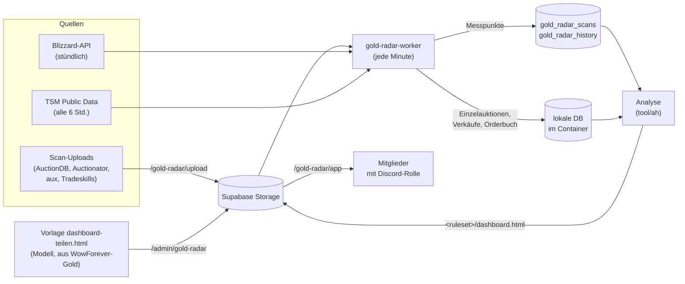

# Blackwater Terminal

Blackwater Terminal (früher „Gold-Radar“) ist das Auktionshaus- und Gold-Tool der Gilde. Es zeigt,
was sich im Auktionshaus von WoW Forever gerade lohnt: Farmen, Handeln, Herstellen.

Die Website liefert es unter `/gold-radar` nur an Mitglieder mit einer bestimmten Discord-Rolle aus.
Die Preise kommen aus den Scans, die Mitglieder hochladen, aus der Blizzard-API und, sobald es sie für
Forever gibt, aus TradeSkillMaster.

## Was das Tool zeigt

| Gruppe | Reiter |
|---|---|
| **Farmen** | Beute-Radar (welche Mats wann gefragt sind), Angel-Radar, Kürschner-Radar |
| **Handeln** | Heute tun, AH-Schnäppchen, Bestseller, Merchant's Favor |
| **Herstellen** | Mats verarbeiten (Make-or-Buy), Berufe-Gewinn, limitierte Rezepte |
| **Überblick** | Spielerzahlen nach Level, Glossar |

## Datenfluss

Kurz zu den Schritten:

1. **Einlesen:** Der Worker liest jede hochgeladene SavedVariables-Datei (`tool/ah/scanfiles.py`,
   `lua_sv.py`). Er speichert jeden Preis-Messpunkt einmal, auch wenn mehrere Leute denselben Scan
   hochladen. Punkte aus der Zukunft (falsche PC-Uhr) verwirft er.
2. **Verkäufe messen:** Bei AuctionDB-Vollscans vergleicht `rawscan.py` aufeinanderfolgende Scans
   Auktion für Auktion. Daraus ergeben sich die gekauften Stück pro Tag, der bezahlte Preis (Median
   und Durchschnitt) und das Orderbuch. Ausgelaufene oder neu eingestellte Auktionen zählen nicht
   als Kauf.
3. **Bereinigen:**
   - Als Preis gilt der billigste Stückpreis.
   - Ein Item mit weniger als 3 Angeboten oder ohne Eintrag im neuesten Scan hat keinen Marktpreis.
   - Der 7-Tage-Median zählt nur Scans mit mindestens 5 Angeboten.
   - Im Orderbuch fallen Fantasiepreise über dem Achtfachen einer robusten Untergrenze weg.
   - Gildenpreise, die stark vom eigenen Scan abweichen, verlieren gegen ihn.
4. **Analysieren:** `analyse.py` und `dashboard.py` berechnen Signale, Tagestipps, Craft-Gewinne
   und Schnäppchen. Daraus baut der Worker mit der hochgeladenen Vorlage die Seite neu.

Der Analyse-Code in `gold-radar-worker/tool/` ist eine Kopie aus dem lokalen Projekt *WowForever-Gold*.
Dort entstehen auch das Nachfrage-Modell, die Vorlage und die Plausibilitätsprüfung. Wer etwas am Code
ändert, kopiert die Datei nach `gold-radar-worker/tool/ah/`, mit LF-Zeilenenden.

## Einrichtung

1. **Rolle anlegen:** Im Discord eine Rolle `Gold-Radar` erstellen und den Leuten geben, die das
   Tool nutzen dürfen. Der Gilden-Bot (`discord-setup/rollensync.py`) meldet sie alle 2 Minuten
   nach `discord_members`. Den Bot danach neu starten, damit er die Rolle mitschickt.
   - Anderer Rollenname: `GOLD_RADAR_ROLES` (Website) und `ZUGANGSROLLEN` (Bot-`.env`) gleich setzen.
   - Standardmäßig geben die Rollen `Gold-Radar` **und** `Beta-Tester` Zugang.
2. **Schema:** `supabase/schema.sql` erneut einspielen. Das legt `gold_radar_usage`,
   `gold_radar_feedback`, die Scan-Tabellen und den privaten Storage-Bucket `gold-radar` an, alles ohne
   Policies und damit nur serverseitig erreichbar.
3. **Umgebung:** `GOLD_RADAR_ADMIN_IDS` auf die Discord-ID(s) setzen, die unter `/admin/gold-radar`
   die Nutzung sehen und Daten hochladen dürfen. Offiziere und Admins haben dieses Recht ausdrücklich
   nicht.
4. **Vorlage hochladen:** In *WowForever-Gold* `python ah/dashboard.py --teilen` ausführen und die
   entstandene `dashboard-teilen.html` unter `/admin/gold-radar` hochladen (Ordner z. B.
   `pvp-eu-horde`). Sie enthält das Nachfrage-Modell, aber keine eigenen Scans.
   - nginx muss dafür Uploads über 1 MB erlauben: `client_max_body_size 50m;` im `server`-Block
     (siehe `deploy/nginx-wowforever.conf.example`).
5. **Worker starten:** `docker compose up -d --build`. Den Log zeigt
   `docker compose logs -f gold-radar-worker`.

### Datenquellen

- **Scan-Uploads:** Mitglieder mit der Rolle laden unter `/gold-radar/upload` die SavedVariables-Datei
  ihres AH-Addons hoch.
  - Am besten ist `AuctionDB.lua` (AuctionDB, WoW-Forever-Ausgabe), weil sie Vollscans mit einzelnen
    Auktionen enthält.
  - Ebenfalls lesbar: `Auctionator.lua`, `aux-addon.lua` und `Blackthornes_TS.lua` (Tradeskills).
  - Unter `/admin/gold-radar` steht jeder Upload und lässt sich zurücknehmen; dabei werden auch
    seine Preise entfernt.
  - Für welche Auktionshäuser Uploads erlaubt sind, regelt `GOLD_RADAR_RULESETS` (Standard:
    `GOLD_RADAR_RULESET`).
- **Blizzard-API:** Mit `BLIZZARD_CLIENT_ID` und `BLIZZARD_CLIENT_SECRET` (develop.battle.net) liest der
  Worker stündlich das ganze Auktionshaus. Forever hat keine Realms, nur Rulesets: `pvp-eu-horde`
  liest `forever:eu:pvp:Horde`. `GOLD_RADAR_BLIZZARD` braucht man nur zum Überschreiben. Prüfen lässt
  es sich mit `docker compose exec gold-radar-worker python blizzard_probe.py`.
- **TradeSkillMaster:** Der Worker prüft einmal am Tag, ob TSM Forever-Daten anbietet, und nutzt sie
  dann alle 6 Stunden. Fest einstellen lässt es sich mit `GOLD_RADAR_TSM=pvp-eu-horde=<Pfad>`.

### Neuigkeiten

Der Worker (`gold-radar-worker/news.py`) sammelt, was den Markt bewegen kann, und zeigt die letzten 30 Tage oben im
Reiter **Goldkalender**:

| Quelle | Wie oft | Was |
|---|---|---|
| Neue Items im AH | bei jedem neuen Scan | Items, die zum ersten Mal in einem Scan oder im Blizzard-Dump auftauchen (der erste Lauf merkt sich nur den Bestand) |
| Blizzard-Blueposts | alle 10 Minuten (`BLUE_MINUTES`) | dieselben Forum-Feeds wie der Discord-Bot, mit vollem Text |
| foreverchanges.pro | alle 3 Stunden (`FC_HOURS`) | RSS der Patchnotes, dazu der Abschnitt mit den Item-Links |
| KI-Wochenbericht | einmal pro Woche | ein geplanter Cloud-Agent über `/api/gold-radar-news` |

Texte werden auf Item-Namen (Deutsch und Englisch) und Stichworte wie Droprate, Rezept, Händler, Auktionshaus,
Händlergunst oder Event abgesucht. Gespeichert wird in der Tabelle `gold_radar_news` (ohne Policies, nur serverseitig).

**Nichts geht von selbst raus.** Unter `/admin/gold-radar` steht jede neue Meldung in „Neuigkeiten freigeben“, sortiert
nach Gold-Bezug. Dort gibst du sie getrennt frei: **auf die Seite** (Goldkalender) und **in Discord posten**: dann
postet der Gilden-Bot Marin sie einmal als Embed (`discord-setup/goldnews.py`, Kanal aus `GOLD_NEWS_KANAL_ID` in
`discord-setup/.env`, sonst `💰│gold-news`). `GOLD_RADAR_NEWS_WEBHOOK` bleibt dafür leer; er ist nur der Weg ohne Bot.
„Verwerfen“ nimmt sie aus der Liste. Beim allerersten Lauf merkt sich der Dienst
die vorhandenen Blueposts und Patchnotes nur, sie landen nicht in der Liste.

Der KI-Wochenbericht braucht `GOLD_RADAR_NEWS_TOKEN` (mindestens 32 Zeichen, z. B. `openssl rand -hex 32`). Mit
diesem Token liest `GET /api/gold-radar-news` die Neuigkeiten und `POST` speichert einen Bericht
(`{title, body, tags?, items?}`, einer pro Tag).

### Feedback und Protokoll

- Feedback aus dem Tool (Knopf „Feedback“) landet in `gold_radar_feedback` und unter
  `/admin/gold-radar`. Mit `GOLD_RADAR_FEEDBACK_WEBHOOK` geht es zusätzlich in einen Discord-Kanal.
- Protokolliert werden nur Discord-ID, Anzeigename, Zeitpunkt, Ruleset und ob der Zugang abgelehnt
  wurde. Wiederholte Aufrufe innerhalb von 15 Minuten zählen einmal. Alte Einträge lassen sich auf der
  Admin-Seite löschen.
- Pro Auktionshaus gibt es im Bucket einen Ordner (`<ruleset>/…`). Aufgerufen wird er mit
  `/gold-radar/app?r=<ruleset>`.
